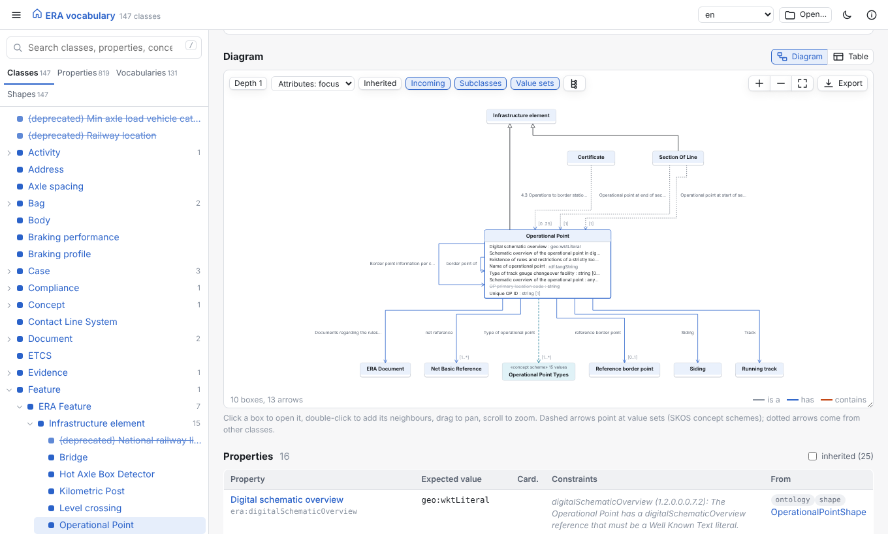
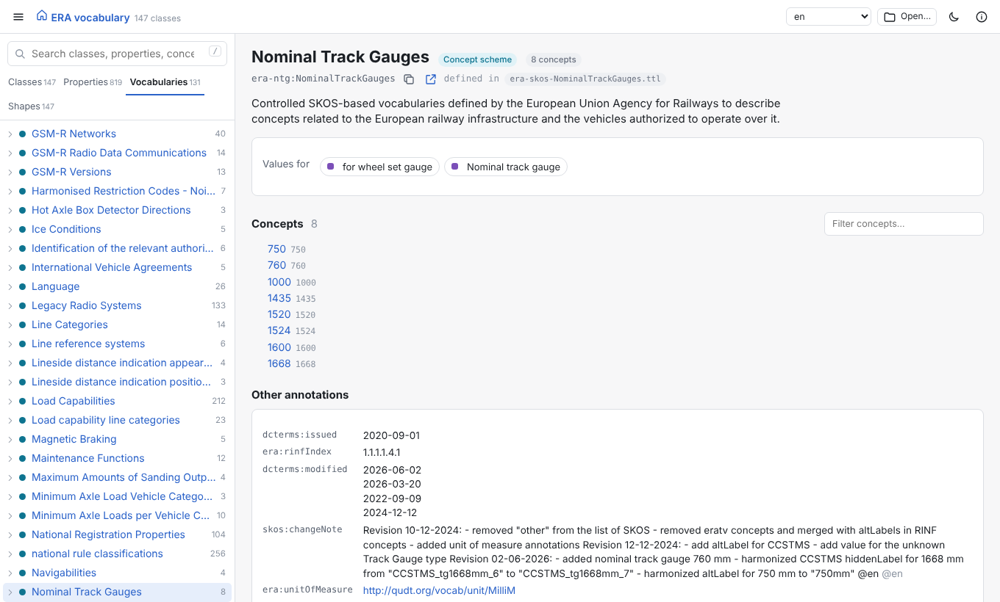
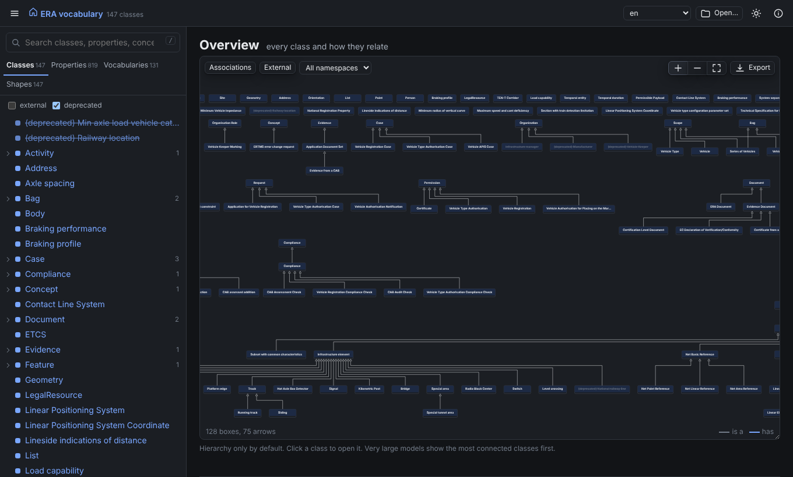

# ontology-explorer

Ontologies, SKOS vocabularies and SHACL shapes as UML-like diagrams and readable pages.

RDF is hard to read for most people, and a big ontology as a list of triples or
references even more so. ontology-explorer reads OWL/RDFS ontologies, SKOS concept
schemes and SHACL shapes together and shows them the way people are used to:
class diagrams, trees, and one page per class with every property it can have,
how many, and what values are allowed.

It runs entirely in the browser, so it can be published on GitHub Pages, and it
ships as a web component for other web apps. A small command-line tool pre-indexes
large models and serves the viewer locally.

**Try it:** <https://matdata-eu.github.io/ontology-explorer/> with the
[ERA vocabulary](https://data-interop.era.europa.eu/era-vocabulary/) of the European
Union Agency for Railways (147 classes, 800 properties, 131 concept schemes,
15,000 concepts, 1,100 property shapes) or a small example library ontology.



## Features

- **Class pages.** Super and subclasses, a diagram of the class and its
  neighbours, and one table with every property: expected value, cardinality,
  constraints, and where each fact comes from (ontology domain/range, OWL
  restrictions or SHACL shapes). Inherited properties are one click away.
- **UML-like diagrams.** Generalisation arrows, associations with multiplicities,
  composition diamonds, value sets drawn as `«concept scheme»` boxes. Double-click
  a box to add its neighbours, change the depth, direction and which attributes
  show. Export as SVG, PNG, PlantUML or Mermaid.
- **Overview map** of every class, by namespace, with or without associations.
- **SKOS vocabularies** as browsable trees with notations, broader/narrower,
  mappings, and the properties that use them as value sets.
- **SHACL shapes** merged into the class tables, and a page per shape with its
  targets, property shapes, node constraints and SPARQL constraints.
- **DASH aware, works without it.** `sh:group` and `sh:order` group and order the
  rows and diagram attributes, `dash:propertyRole` marks labels and identifiers,
  `dash:abstract` marks abstract classes, `dash:composite` draws composition,
  `dash:hidden` and `dash:readOnly` are respected. Without DASH, the viewer falls
  back to sensible defaults.
- **Value sets are detected** from a property pointing at a concept scheme, from
  `sh:in` lists of one scheme's concepts, and from `sh:node` shapes that pin
  `skos:inScheme`.
- **Fast.** Search ranks classes and properties first and answers as you type.
  The ERA vocabulary (100,000 triples) is indexed in about a second, in Rust,
  either ahead of time or in the browser through WebAssembly. Diagram layout runs
  in a web worker with the [Eclipse Layout Kernel](https://eclipse.dev/elk/).
- **Labels in every language** the data has, light and dark themes, links you can
  share to any class, property, concept or shape.

| | |
| --- | --- |
|  |  |

## Install

- **No install:** open <https://matdata-eu.github.io/ontology-explorer/> and drop
  your files on it. Files are read in your browser; nothing is uploaded.
- **Binaries** for Linux, macOS and Windows are attached to each
  [release](https://github.com/Matdata-eu/ontology-explorer/releases).
- **Cargo:** `cargo install ontology-explorer`
- **Docker:** `ghcr.io/matdata-eu/ontology-explorer`
- **npm** (the web component): `npm install @matdata/ontology-explorer`

## Usage

### Open files in the viewer

```sh
ontology-explorer serve ontology.ttl shapes.ttl vocabularies/*.ttl
```

This indexes the files, starts a local web server on <http://127.0.0.1:7878/> and
opens the browser. Inputs can be files or URLs, in Turtle, N-Triples, TriG,
N-Quads, RDF/XML or JSON-LD, optionally gzip-compressed, in any order.

The ERA vocabulary is not stored in this repository. Fetch it and open it with:

```sh
scripts/fetch-era.sh
ontology-explorer serve examples/era/ontology.ttl examples/era/era-shacl/*.ttl examples/era/era-skos/*.ttl
```

`serve` options, each also settable through an environment variable:

| Flag | Environment variable | Default | |
| --- | --- | --- | --- |
| `--bind` | `ONTOLOGY_EXPLORER_BIND` | `127.0.0.1:7878` | Address to listen on |
| `--title` | `ONTOLOGY_EXPLORER_TITLE` | the ontology's title | Title in the viewer |
| `--no-open` | `ONTOLOGY_EXPLORER_NO_OPEN` | | Do not open a browser |
| `--relay` | `ONTOLOGY_EXPLORER_RELAY` | off | Let the viewer fetch any URL through the server, for sites without CORS |
| `--max-upload-mb` | `ONTOLOGY_EXPLORER_MAX_UPLOAD_MB` | `256` | Largest upload the server parses for the viewer |
| `--max-individuals` | | `200` | Instances kept per class |

### Publish your own ontology as a static site

Build the pre-indexed bundle once, and host it next to the viewer on any static
web host, GitHub Pages included:

```sh
ontology-explorer build ontology.ttl shapes.ttl vocabularies/*.ttl -o site/model.json
```

Then open the viewer with `?src=model.json`, or embed it (below). The bundle is
plain JSON. Web servers usually compress it: the ERA bundle is 7 MB, 0.9 MB over
the wire. `--gzip` also writes a `.json.gz` copy for hosts that do not compress.

To serve a model with Docker:

```sh
docker run --rm -p 8080:8080 -v "$PWD:/data" ghcr.io/matdata-eu/ontology-explorer \
  serve --no-open ontology.ttl shapes.ttl
```

### Links

Every view has its own URL, so links can be shared or put in documentation:

| URL | Opens |
| --- | --- |
| `?src=model.json` | the model at that URL (a bundle or RDF files) |
| `#/e/<IRI>` or `#/e/<curie>` | the page of a class, property, concept, scheme or shape |
| `#/e/<IRI>?tab=table` | a class page with the table instead of the diagram |
| `#/overview` | the overview map |

### Embed the web component

```html
<script type="module" src="https://cdn.jsdelivr.net/npm/@matdata/ontology-explorer/dist-lib/ontology-explorer.js"></script>

<ontology-explorer src="model.json" focus="http://data.europa.eu/949/Track" style="height: 720px"></ontology-explorer>
```

Or in an app with a bundler:

```js
import "@matdata/ontology-explorer"; // registers <ontology-explorer>
```

The element works the same in React, Vue, Angular, Svelte or plain HTML.

| Attribute | |
| --- | --- |
| `src` | URL of a bundle (`ontology-explorer build`) or of an RDF file |
| `focus` | IRI or curie to open first |
| `lang` | Label language |
| `theme` | `light`, `dark` or `auto` |
| `minimal` | Show only the page, without the sidebar and top bar |
| `routing` | Use the page's `location.hash` for navigation (the standalone app does) |
| `examples` | URL of a JSON list of examples for the open screen |

| Method or property | |
| --- | --- |
| `load(urlOrBundleOrFiles)` | Load a bundle object, a URL, or a `FileList` of RDF files |
| `goTo(iri, tab?)` | Open an entity; returns `false` when it is not in the model |
| `bundle` | The loaded bundle |

| Event | `detail` |
| --- | --- |
| `oe-navigate` | `{ iri, route }` |
| `oe-loaded` | `{ bundle }` |
| `oe-error` | `{ error }` |

The component renders in a shadow root. Its colours are CSS custom properties
(`--oe-accent`, `--oe-bg`, `--oe-text` and others in `web/src/styles.css`) that a
host page can override on the element.

### How the model is read

| Source | Becomes |
| --- | --- |
| `owl:Class`, `rdfs:Class`, `rdfs:subClassOf`, `owl:equivalentClass`, `owl:unionOf`, `owl:disjointWith` | classes and their hierarchy |
| `rdfs:domain`, `rdfs:range`, `schema:domainIncludes`, `schema:rangeIncludes` | property rows of a class |
| `owl:Restriction` (cardinalities, `someValuesFrom`, `allValuesFrom`, `hasValue`) | property rows with cardinality and range |
| `sh:NodeShape` with `sh:targetClass`, implicit class targets, `dash:applicableToClass` | the class's property rows, merged with the ontology by path |
| `sh:minCount`, `sh:maxCount`, `sh:class`, `sh:datatype`, `sh:node`, `sh:in`, `sh:pattern` and other constraints | cardinality, expected value and constraints |
| `sh:group`, `sh:order`, `dash:propertyRole`, `dash:abstract`, `dash:composite`, `dash:hidden`, `dash:readOnly` | grouping, order and UML notation |
| `skos:ConceptScheme`, `skos:Concept`, `broader`/`narrower`, `skos:Collection` | vocabulary trees and value sets |
| `rdfs:label`, `skos:prefLabel`, `sh:name`, `dcterms:title`, … and comments, definitions, descriptions | names and descriptions in every language |
| `owl:deprecated`, `vs:term_status` | deprecated entries, struck through |

## Development

The repository is a Rust workspace with a TypeScript web viewer:

| Path | |
| --- | --- |
| `crates/core` | Parses the RDF and builds the indexed model (`ontology-explorer-core`) |
| `crates/cli` | The `ontology-explorer` command line and web server |
| `crates/wasm` | The core compiled to WebAssembly for the browser |
| `web/` | The viewer: app, web component, diagrams (Vite and TypeScript) |
| `examples/library` | A small ontology with SKOS, SHACL and DASH that uses every feature |

You need Rust with the `wasm32-unknown-unknown` target, `wasm-bindgen-cli` at the
version in `Cargo.lock`, and Node.js 20 or later.

```sh
rustup target add wasm32-unknown-unknown
cargo install wasm-bindgen-cli --version 0.2.129
cd web && npm ci && npm run build && cd ..   # builds the WebAssembly module and web/dist
cargo build --release                          # embeds web/dist in the binary
cargo test
cd web && npm run dev                          # the viewer with hot reload on http://localhost:5173
```

`THIRD_PARTY_NOTICES.md` is generated with
`cargo about generate about.hbs -o THIRD_PARTY_NOTICES.md`.

## Questions, bugs and feature requests

Please open an issue on GitHub:
<https://github.com/Matdata-eu/ontology-explorer/issues>.

## Credits

ontology-explorer is written by Mathias Vanden Auweele ([Matdata](https://matdata.eu/)).

It is built on these open source projects:

- [Oxigraph](https://github.com/oxigraph/oxigraph)'s `oxrdf`, `oxttl`, `oxrdfxml`
  and `oxjsonld` crates for RDF parsing (MIT / Apache-2.0)
- [ELK.js](https://github.com/kieler/elkjs), the Eclipse Layout Kernel, for
  diagram layout (EPL-2.0)
- [wasm-bindgen](https://github.com/rustwasm/wasm-bindgen) for the WebAssembly
  build (MIT / Apache-2.0)
- [axum](https://github.com/tokio-rs/axum) and [Tokio](https://tokio.rs) for the
  local server, [ureq](https://github.com/algesten/ureq) for loading URLs,
  [clap](https://github.com/clap-rs/clap) for the command line (MIT / Apache-2.0)
- [Vite](https://vite.dev) and [TypeScript](https://www.typescriptlang.org) to
  build the viewer
- The popular prefixes of [prefix.cc](https://prefix.cc), for shortening IRIs
- The [ERA vocabulary](https://gitlab.com/era-europa-eu/public/interoperable-data-programme/era-ontology/era-ontology)
  of the European Union Agency for Railways, the reference large example
  (EUPL 1.2 and CC BY 4.0; not included in this repository)

The full list, with license texts, is in
[THIRD_PARTY_NOTICES.md](THIRD_PARTY_NOTICES.md). The local server shows it at
`/licenses` and the viewer links to it from its About dialog.

## License

Licensed under the [Apache License 2.0](LICENSE).
